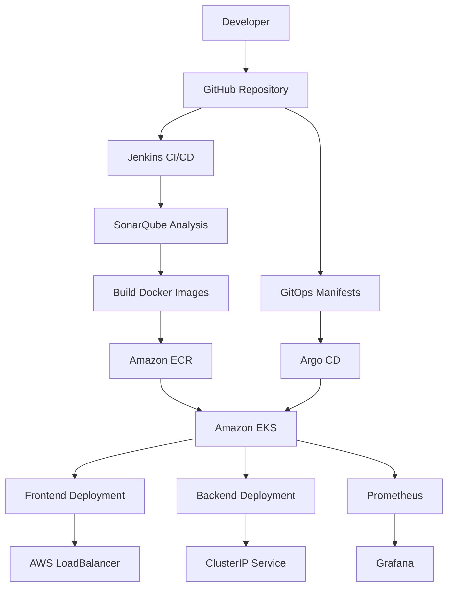

# NutriFlow — DevOps Project Documentation

> Scope: AWS infrastructure, containerization, CI/CD, Kubernetes, GitOps, and monitoring only. Application features and business logic are intentionally excluded.

## 1. Project Overview

NutriFlow is deployed as separate frontend and backend containers. The DevOps workflow uses:

- Terraform – Infrastructure as Code
- AWS EC2 – Jenkins and SonarQube hosting
- Amazon ECR – Docker image registry
- Docker – Containerization
- Jenkins – CI/CD automation
- SonarQube – Static code analysis
- Amazon EKS – Kubernetes orchestration
- Argo CD – GitOps deployment
- Helm – Kubernetes package management
- Prometheus – Metrics collection
- Grafana – Monitoring dashboards

## 2. DevOps Architecture



### Deployment Workflow

1. Developer pushes code to GitHub.
2. Jenkins checks out the source code.
3. SonarQube performs static code analysis.
4. Jenkins builds frontend and backend Docker images.
5. Images are pushed to Amazon ECR.
6. Kubernetes deploys the application on Amazon EKS.
7. Argo CD monitors GitHub GitOps manifests and synchronizes Kubernetes resources.
8. Prometheus collects metrics.
9. Grafana visualizes infrastructure and application metrics.

## 3. AWS Infrastructure

| Component | Configuration |
|---|---|
| AWS Region | ap-south-1 |
| EKS Cluster | nutriflow-eks |
| Worker Nodes | 2 |
| Instance Type | t3.medium |
| Application Namespace | nutriflow |
| Argo CD Namespace | argocd |
| Monitoring Namespace | monitoring |
| ECR Backend Repository | nutriflow-backend |
| ECR Frontend Repository | nutriflow-frontend |

### Terraform Resources

The Terraform state contained:

- aws_eks_cluster.nutriflow
- aws_eks_node_group.nutriflow_nodes
- aws_iam_role.eks_cluster_role
- aws_iam_role.eks_node_role
- EKS IAM policy attachments

Terraform was operated using the `nutriflow-terraform` AWS profile, which assumes the `NutriFlowTerraformRole`.

### Terraform Commands

Navigate to the Terraform directory:

```bash
cd ~/nutriflow/terraform
```

Check Terraform version:

```bash
terraform version
```

Check AWS identity:

```bash
aws sts get-caller-identity --profile nutriflow-terraform
```

Initialize Terraform:

```bash
AWS_PROFILE=nutriflow-terraform terraform init
```

Validate configuration:

```bash
terraform validate
```

Preview infrastructure changes:

```bash
AWS_PROFILE=nutriflow-terraform terraform plan
```

Create infrastructure:

```bash
AWS_PROFILE=nutriflow-terraform terraform apply
```

List Terraform-managed resources:

```bash
terraform state list
```

Preview infrastructure destruction:

```bash
AWS_PROFILE=nutriflow-terraform terraform plan -destroy
```

Destroy infrastructure only after reviewing the plan:

```bash
AWS_PROFILE=nutriflow-terraform terraform destroy
```

**Important:** Always review the Terraform destruction plan. Ensure it does not include your Jenkins/SonarQube EC2 instance or ECR repositories that you want to retain. Also check for separately managed LoadBalancers, volumes, Elastic IPs, NAT Gateways, and networking resources.

## 4. Configure kubectl for EKS

Configure kubeconfig:

```bash
aws eks update-kubeconfig \
  --region ap-south-1 \
  --name nutriflow-eks
```

Check nodes:

```bash
kubectl get nodes
```

Check namespaces:

```bash
kubectl get namespaces
```

Check all pods:

```bash
kubectl get pods -A
```

Useful Kubernetes commands:

```bash
kubectl get deployments -n nutriflow
kubectl get services -n nutriflow
kubectl get pods -n nutriflow -o wide
```

Describe a pod:

```bash
kubectl describe pod <pod-name> -n nutriflow
```

View logs:

```bash
kubectl logs <pod-name> -n nutriflow
```

Check deployment rollout:

```bash
kubectl rollout status deployment/backend -n nutriflow
kubectl rollout status deployment/frontend -n nutriflow
```

## 5. Docker and Amazon ECR

Two ECR repositories were used:

- nutriflow-backend
- nutriflow-frontend

### Authenticate Docker to ECR

```bash
aws ecr get-login-password --region ap-south-1 \
  | docker login --username AWS --password-stdin \
  <AWS_ACCOUNT_ID>.dkr.ecr.ap-south-1.amazonaws.com
```

### Build Docker Images

Run from the repository root:

```bash
docker build -t nutriflow-backend:v1 ./backend
```

```bash
docker build -t nutriflow-frontend:v1 ./frontend
```

### Tag Images

```bash
docker tag nutriflow-backend:v1 \
  <AWS_ACCOUNT_ID>.dkr.ecr.ap-south-1.amazonaws.com/nutriflow-backend:<IMAGE_TAG>
```

```bash
docker tag nutriflow-frontend:v1 \
  <AWS_ACCOUNT_ID>.dkr.ecr.ap-south-1.amazonaws.com/nutriflow-frontend:<IMAGE_TAG>
```

### Push Images to ECR

```bash
docker push <AWS_ACCOUNT_ID>.dkr.ecr.ap-south-1.amazonaws.com/nutriflow-backend:<IMAGE_TAG>
```

```bash
docker push <AWS_ACCOUNT_ID>.dkr.ecr.ap-south-1.amazonaws.com/nutriflow-frontend:<IMAGE_TAG>
```

### Verify ECR Images

```bash
aws ecr describe-images \
  --repository-name nutriflow-backend \
  --region ap-south-1
```

```bash
aws ecr describe-images \
  --repository-name nutriflow-frontend \
  --region ap-south-1
```

Replace `<AWS_ACCOUNT_ID>` and `<IMAGE_TAG>` with the appropriate values.

## 6. Jenkins CI/CD Pipeline

Jenkins was hosted on a separate EC2 instance.

The pipeline included these stages:

1. Checkout
2. SonarQube Analysis
3. Build Docker Images
4. Push Images to ECR
5. Deploy to EKS

### Jenkins Credentials

| Credential ID | Purpose |
|---|---|
| aws-credentials | AWS credentials |
| sonarqube-token | SonarQube analysis token |

Actual credential values are stored in Jenkins Credentials and must never be committed to GitHub.

### Kubernetes Deployment Commands

The earlier Jenkins pipeline deployed images using `kubectl set image`.

Backend:

```bash
kubectl set image deployment/backend \
  backend=<ECR_BACKEND_IMAGE> \
  -n nutriflow
```

Frontend:

```bash
kubectl set image deployment/frontend \
  frontend=<ECR_FRONTEND_IMAGE> \
  -n nutriflow
```

Check rollout:

```bash
kubectl rollout status deployment/backend -n nutriflow
kubectl rollout status deployment/frontend -n nutriflow
```

### GitOps Pipeline Integration

After Argo CD was introduced, the intended fully GitOps-based workflow is:

1. Jenkins builds Docker images.
2. Jenkins pushes images to ECR.
3. Jenkins updates image tags in GitOps manifests.
4. Jenkins commits and pushes the changes to GitHub.
5. Argo CD detects the Git changes.
6. Argo CD synchronizes the updated Kubernetes resources.

For a fully GitOps-managed deployment, Jenkins should update Git manifests rather than directly running `kubectl set image`. Avoid having Jenkins and Argo CD independently modify the same Deployment.

## 7. SonarQube Integration

SonarQube was integrated into the Jenkins pipeline for static code analysis.

Project key:

```text
NutriFlow
```

Jenkins credential ID:

```text
sonarqube-token
```

The SonarQube project key is case-sensitive.

The pipeline runs SonarQube analysis before building and pushing Docker images.

Never store SonarQube tokens inside the Jenkinsfile or Git repository.

## 8. Argo CD – GitOps Deployment

Argo CD was installed in the `argocd` namespace.

### GitHub Repository Configuration

| Setting | Value |
|---|---|
| Repository | https://github.com/Navaneethkrishna-coder/nutriflow.git |
| Branch | main |
| Manifest Path | k8s/argocd |
| Argo CD Namespace | argocd |
| Destination Namespace | nutriflow |
| Application Name | nutriflow |

### GitOps Directory Structure

```text
k8s/
└── argocd/
    ├── backend.yaml
    ├── frontend.yaml
    └── nutriflow-app.yaml
```

The GitOps manifests preserve:

- Backend Service – ClusterIP
- Frontend Service – LoadBalancer
- Backend replicas – 2
- Frontend replicas – 2
- Existing backend secret reference – nutriflow-backend-env

Secret values are not stored in Git.

### Install Argo CD

Only if it is not already installed:

```bash
kubectl create namespace argocd
```

```bash
kubectl apply -n argocd \
  -f https://raw.githubusercontent.com/argoproj/argo-cd/stable/manifests/install.yaml
```

Check Argo CD pods:

```bash
kubectl get pods -n argocd
```

Apply the NutriFlow Application:

```bash
kubectl apply -f k8s/argocd/nutriflow-app.yaml
```

Check application status:

```bash
kubectl get applications -n argocd
```

Describe application:

```bash
kubectl describe application nutriflow -n argocd
```

Refresh application:

```bash
kubectl annotate application nutriflow \
  -n argocd \
  argocd.argoproj.io/refresh=hard \
  --overwrite
```

### Retrieve Initial Admin Password

```bash
kubectl get secret argocd-initial-admin-secret \
  -n argocd \
  -o jsonpath='{.data.password}' | base64 -d
```

Keep the password private.

### Access Argo CD Dashboard

```bash
kubectl port-forward svc/argocd-server \
  -n argocd 8081:443
```

Open:

```text
https://localhost:8081
```

Use username `admin` and the initial password.

Restrict dashboard access to trusted IP addresses. Do not expose the dashboard to `0.0.0.0/0`.

**Verification:** The NutriFlow Argo CD application was confirmed Healthy and Synced.

## 9. Prometheus and Grafana Monitoring

Prometheus and Grafana were installed using Helm and the Prometheus Community chart:

```text
kube-prometheus-stack
```

Chart version:

```text
93.9.0
```

Monitoring namespace:

```text
monitoring
```

### Components Installed

- Prometheus
- Grafana
- Prometheus Operator
- Node Exporter
- kube-state-metrics

### Install Helm

Verify:

```bash
helm version
```

### Add Prometheus Community Repository

```bash
helm repo add prometheus-community \
  https://prometheus-community.github.io/helm-charts
```

Update repository:

```bash
helm repo update
```

Create monitoring namespace:

```bash
kubectl create namespace monitoring
```

### Download Helm Chart

```bash
helm pull prometheus-community/kube-prometheus-stack \
  --version 93.9.0 \
  --untar
```

### Validate Helm Configuration

```bash
helm lint ./kube-prometheus-stack \
  -f monitoring-values.yaml
```

### Install Prometheus and Grafana

```bash
helm install monitoring prometheus-community/kube-prometheus-stack \
  --namespace monitoring \
  --version 93.9.0 \
  -f monitoring-values.yaml \
  --wait \
  --timeout 10m
```

### Monitoring Configuration

The `monitoring-values.yaml` configuration used:

- Grafana enabled
- Grafana persistence disabled
- Prometheus enabled
- Prometheus replicas: 1
- Prometheus retention: 3 days
- Alertmanager disabled
- kube-state-metrics enabled
- Node Exporter enabled
- Resource requests and limits configured for monitoring components

Because persistence was disabled, Prometheus data is temporary and can be lost if its pod is recreated.

### Verify Monitoring Installation

```bash
helm list -n monitoring
```

```bash
kubectl get pods -n monitoring
```

```bash
kubectl get services -n monitoring
```

```bash
kubectl get prometheus -n monitoring
```

### Retrieve Grafana Admin Password

```bash
kubectl get secret monitoring-grafana \
  -n monitoring \
  -o jsonpath="{.data.admin-password}" | base64 -d
```

### Access Grafana Dashboard

```bash
kubectl port-forward svc/monitoring-grafana \
  -n monitoring 3000:80
```

Open:

```text
http://localhost:3000
```

Username:

```text
admin
```

Use the retrieved password.

Grafana is configured with Prometheus as its data source through the Helm chart. Kubernetes dashboards are included.

### Monitoring Limitations

During validation:

```bash
kubectl top nodes
```

returned:

```text
Metrics API not available
```

Metrics Server was not confirmed installed. This is separate from Prometheus metrics collection.

The cluster's `gp2` StorageClass used the in-tree EBS provisioner. The available CSI driver was `efs.csi.aws.com`; an EBS CSI driver was not present.

Prometheus persistent storage was not configured.

## 10. Useful Kubernetes Commands

Check nodes:

```bash
kubectl get nodes
```

Check all pods:

```bash
kubectl get pods -A
```

Check NutriFlow deployments:

```bash
kubectl get deployments -n nutriflow
```

Check NutriFlow services:

```bash
kubectl get services -n nutriflow
```

Check Argo CD:

```bash
kubectl get pods -n argocd
kubectl get applications -n argocd
```

Check monitoring:

```bash
kubectl get pods -n monitoring
```

View logs:

```bash
kubectl logs <pod-name> -n <namespace>
```

Describe a pod:

```bash
kubectl describe pod <pod-name> -n <namespace>
```

View events:

```bash
kubectl get events -n <namespace> \
  --sort-by=.metadata.creationTimestamp
```

## 11. Useful Helm Commands

List releases:

```bash
helm list -n monitoring
```

Check release status:

```bash
helm status monitoring -n monitoring
```

View configured values:

```bash
helm get values monitoring -n monitoring
```

## 12. Security and Best Practices

- Store AWS credentials securely.
- Use Jenkins Credentials for tokens and passwords.
- Never commit API keys, database credentials, or Kubernetes Secret values.
- Do not commit Terraform state files.
- Restrict Jenkins, SonarQube, Argo CD, and Grafana access to trusted IP addresses.
- Use immutable Docker image tags.
- Review Terraform plans before applying or destroying infrastructure.
- Maintain backups of important Terraform state and configuration files.
- Check for billable AWS resources after cluster cleanup, including LoadBalancers, EBS/EFS volumes, Elastic IPs, NAT Gateways, and the EKS control plane.

Jenkins and SonarQube were running on a separate EC2 instance. Do not include that EC2 instance in an EKS-only destruction operation unless intentionally decommissioning it.

## 13. Implementation Status

| Component | Status |
|---|---|
| Terraform | EKS infrastructure created and managed in Terraform state |
| Amazon EKS | Created; two worker nodes previously verified Ready |
| Amazon ECR | Backend and frontend repositories used |
| Docker | Frontend and backend images built |
| Jenkins | CI/CD pipeline configured |
| SonarQube | Analysis stage completed successfully |
| Kubernetes | Frontend and backend deployments running |
| Argo CD | Application verified Healthy and Synced |
| Helm | Installed |
| Prometheus | Helm installation successful |
| Grafana | Installed and dashboard login completed |
| Prometheus Persistence | Disabled; data temporary |
| Metrics Server | Metrics API unavailable during validation |
| EKS Destruction | Not confirmed |

## 14. DevOps Repository Structure

```text
nutriflow/
├── Jenkinsfile
├── docker-compose.yml
├── backend/
│   └── Dockerfile
├── frontend/
│   └── Dockerfile
├── k8s/
│   ├── backend.yaml
│   ├── frontend.yaml
│   └── argocd/
│       ├── backend.yaml
│       ├── frontend.yaml
│       └── nutriflow-app.yaml
└── terraform/
    └── *.tf
```

This is a representative DevOps-focused layout. Exact filenames may vary in the current repository.

## 15. Conclusion

The NutriFlow DevOps project demonstrates an end-to-end cloud deployment and monitoring workflow using:

- Infrastructure as Code with Terraform
- Containerization with Docker
- Container image management with Amazon ECR
- CI/CD automation with Jenkins
- Static code analysis with SonarQube
- Container orchestration with Amazon EKS and Kubernetes
- GitOps-based deployment with Argo CD
- Metrics collection with Prometheus
- Infrastructure monitoring and visualization with Grafana

This project provided hands-on experience with AWS infrastructure, CI/CD pipelines, Kubernetes deployments, GitOps workflows, and cloud-native monitoring.

